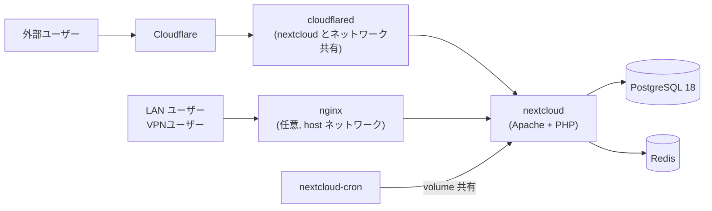

# Nextcloud with Docker


Docker Compose で Nextcloud を構築するためのリポジトリです  
Cloudflare Tunnel による外部公開と、nginx による LAN からの HTTPS 接続に対応しています  
データベースは PostgreSQL 18 で、キャッシュに Redis、定期処理に専用の cron コンテナを使います

> [!WARNING]
> メジャーアップデートは 2 個以上またげないので、1 バージョンずつ上げてください (詳細は「アップグレード」)

## 構成



cloudflared は `network_mode: service:nextcloud` で nextcloud とネットワーク空間を共有し、nginx は `network_mode: host` でホストの 443 番を直接リッスンします  
`HTTP_PORT` で LAN から直接 HTTP アクセスすることもできます

## 動作環境

| 項目 | 要件 |
|---|---|
| ホスト | Docker Compose が動く Linux (同梱スクリプトは `sudo bash` で実行します) |
| Nextcloud | 35 (`.env` の `NEXTCLOUD_VERSION` で変更できます) |
| データベース | PostgreSQL 18 |
| キャッシュ | Redis (alpine イメージ) |
| 外部公開 | Cloudflare Tunnel (任意) / nginx (任意) |

## セットアップ

1. リポジトリを clone します

   ```bash
   git clone https://github.com/kuwacom/Nextcloud-with-Docker.git
   cd Nextcloud-with-Docker
   ```

2. `.env` を作成して編集します

   ```bash
   cp .env.example .env
   ```

3. コンテナを起動します

   ```bash
   docker compose up -d
   ```

4. ブラウザで `http://localhost:<HTTP_PORT>` にアクセスし、Nextcloud の案内が表示されれば成功です

> [!IMPORTANT]
> Nextcloud 本体 (`/var/www/html`) は名前付きボリュームです  
> 初回起動時に公式 entrypoint が管理ユーザーの作成とインストールまで自動で行います

環境固有の設定 (リモートマウントの追加など) は `docker-compose.yaml` に書かず、`docker-compose.override.example.yaml` を `docker-compose.override.yaml` にコピーして分離します  
override ファイルは `docker compose` が自動で読み込み、git にはコミットされません

## .env の設定項目

| 変数 | 説明 | 例 |
|---|---|---|
| `NEXTCLOUD_VERSION` | Nextcloud のバージョン | `35` |
| `HTTP_PORT` | Nextcloud をホストに公開するポート | `80` |
| `NEXTCLOUD_TRUSTED_DOMAINS` | 信頼するドメイン (スペース区切り) | `nextcloud localhost example.com` |
| `ADMIN_USERNAME` / `ADMIN_PASSWORD` | 管理者ユーザー名とパスワード | - |
| `DEFAULT_LANGUAGE` | 既定の言語 | `ja` |
| `DB_NAME` / `DB_USER` / `DB_PASSWORD` | PostgreSQL のデータベース名・ユーザー・パスワード | - |
| `DB_DATA_DIR` | PostgreSQL のデータ配置先 | `./postgres` |
| `MARIADB_ROOT_PASSWORD` | 移行用 MariaDB の root パスワード (移行時のみ、既存 DB の値を設定します) | - |
| `CLOUDFLARE_TUNNEL_TOKEN` | Cloudflare Tunnel のトークン | - |

> [!NOTE]
> `DB_DATA_DIR` にはホスト上の任意のパスを指定できます  
> DB はランダムアクセスが多いため、NFS や CephFS などのネットワークファイルシステムではなくローカルディスクに配置することを推奨します

## 外部公開

### Cloudflare Tunnel

1. [Cloudflare Zero Trust ダッシュボード](https://one.dash.cloudflare.com/) で Network -> Tunnels からトンネルを作成します
2. トークンを `.env` の `CLOUDFLARE_TUNNEL_TOKEN` に設定します
3. 公開ホスト名のエンドポイントに、宛先 `http://localhost:80` を設定します

cloudflared は nextcloud とネットワーク空間を共有しているため、宛先は `localhost` で到達できます

### nginx (LAN から HTTPS)

1. `nginx/conf.d/default.conf` の `server_name` にアクセスに使うドメイン名を記入します

   ```conf
   server_name         localhost example.com; # アクセスするドメイン名を指定
   ```

2. `nginx/certs/` に秘密鍵 `privkey.pem` と、サーバー証明書と中間証明書を統合した `fullchain.pem` を配置します  
   オレオレ証明書でよい場合は同梱の `create-certs.sh` を使えます
3. `proxy_pass` の宛先は `.env` の `HTTP_PORT` に合わせます (既定は 80 番なので `http://localhost` のままで構いません)

### リモート IP を正しく取得する

リバースプロキシや Cloudflare Tunnel の下では、既定の設定だとリモート IP がプロキシの IP になり、ブルートフォース制限やログが正しく機能しません  
セットアップ完了後、`nextcloud/config/config.php` の `$CONFIG = array(` 内に次の設定を追加します

```php
  'trusted_proxies' =>
  array(
    0 => '127.0.0.1',
  ),
  'forwarded_for_headers' =>
  array(
    0 => 'HTTP_CF_CONNECTING_IP',
    1 => 'HTTP_X_FORWARDED_FOR',
  ),
```

cloudflared も nginx (host ネットワーク) も nextcloud へは `127.0.0.1` からアクセスするため、信頼するプロキシは `127.0.0.1` で問題ありません  
`forwarded_for_headers` は利用するリバースプロキシによって異なるので、事前に確認してください

ブラウザでログイン後、管理者設定 -> セキュリティ で接続元の IP が表示されていれば成功です


## 運用

### アップグレード

公式イメージの entrypoint が起動時に `version.php` とイメージのバージョンを比較し、自動で `occ upgrade` を実行するため、新しいバージョンで起動するだけでアップグレードが完了します

1. 現行バージョンのままアプリを App Store の最新に更新します

   ```bash
   sudo bash prepare-upgrade.sh
   ```

2. `.env` の `NEXTCLOUD_VERSION` を 1 つだけ上げます

   ```text
   nextcloud:30 -> nextcloud:31 -> nextcloud:32   # OK
   nextcloud:30 -> nextcloud:32                   # 不可
   ```

3. 通常どおり起動し、自動アップグレードの進行を確認します

   ```bash
   sudo bash start.sh
   docker compose logs -f nextcloud
   ```

4. 非互換アプリで自動アップグレードが止まったら、復旧と事後処理をまとめて実行します

   ```bash
   sudo bash upgrade-nextcloud.sh
   ```

> [!WARNING]
> 本体のボリューム (`nextcloud`) は消さないでください。`delete.sh` で消すと、entrypoint がインストール済みのバージョン (`version.php`) を判定できなくなり、自動アップグレードが行われません  
> 消してしまった場合は、起動後に `upgrade-nextcloud.sh` で手動アップグレードします (config・data・custom_apps はバインドマウントなので消えません)

### アップロード上限

アップロード上限は複数の層の設定で決まり、もっとも小さい値が有効になります

| 層 | 設定箇所 | 本リポジトリの既定 |
|---|---|---|
| Apache | `APACHE_BODY_LIMIT` (docker-compose.yaml) | 0 (無制限) |
| PHP | `PHP_UPLOAD_LIMIT` (docker-compose.yaml) | 10G |
| nginx | `client_max_body_size` (nginx/conf.d) | 20G |

> [!WARNING]
> `APACHE_BODY_LIMIT` を未設定にすると Apache の既定値 1GB が有効になり、PHP や nginx を大きくしても 1GB で打ち切られます

Cloudflare 経由で公開する場合は、Cloudflare 側の制限も別途効きます  
無料プランのリクエスト上限は 100MB ですが、チャンクアップロード (ログイン時や NC32 以降の公開リンク) で回避できます

### SMB 外部ストレージ

Nextcloud の公式イメージには SMB クライアント拡張 (smbclient) が含まれないため、`files_external` で SMB 外部ストレージを使う場合は導入が必要です

```bash
sudo bash install-smb-lib.sh
```

> [!WARNING]
> コンテナはイメージ更新 (バージョンアップ) のたびに作り直されるため、導入した拡張は消失します  
> バージョンアップのたびに `install-smb-lib.sh` を再実行してください

### 権限の修復

バックアップからの復旧や WSL での起動などで、`nextcloud/` 配下の所有者やパーミッションがリセットされて正常に動かなくなることがあります  
その場合は `reset-permissions.sh` で所定の値に戻せます

```bash
sudo bash ./reset-permissions.sh
```

バインドマウントはホスト側の権限が使われるため、ファイルの所有者が `www-data` 以外だと `update-htaccess.sh` などが動かなくなることがあります  
この場合は書き換わるファイルの所有者を実行ユーザーに合わせてからコマンドを実行します

```bash
docker exec nextcloud_app chown 1000:1000 /var/www/html/.htaccess
docker exec -u 1000 nextcloud_app php /var/www/html/occ maintenance:update:htaccess
```

### ファイルの再スキャン

Nextcloud の外側でファイルを追加・削除した場合は、再スキャンでデータディレクトリの実態と同期します

```bash
sudo bash all-file-scan.sh
```

## スクリプト一覧

| ファイル | 用途 | 実行例 |
|---|---|---|
| `start.sh` | コンテナの起動 | `sudo bash start.sh` |
| `stop.sh` | コンテナの停止 | `sudo bash stop.sh` |
| `delete.sh` | コンテナと本体ボリュームの削除 (本体を作り直したいときだけ使います) | `sudo bash delete.sh` |
| `prepare-upgrade.sh` | メジャーアップグレード前のアプリ一括更新 | `sudo bash prepare-upgrade.sh` |
| `upgrade-nextcloud.sh` | 自動 upgrade が止まったときの復旧と事後処理 | `sudo bash upgrade-nextcloud.sh` |
| `install-smb-lib.sh` | SMB クライアント拡張の導入 (イメージ更新ごとに再実行) | `sudo bash install-smb-lib.sh` |
| `reset-permissions.sh` | バインドマウント領域の権限修復 | `sudo bash reset-permissions.sh` |
| `update-htaccess.sh` | `.htaccess` の更新 | `sudo bash update-htaccess.sh` |
| `all-file-scan.sh` | 全ユーザーのファイル再スキャン | `sudo bash all-file-scan.sh` |
| `create-certs.sh` | オレオレ証明書の作成 | `bash create-certs.sh` |
| `cron.sh` | cron コンテナ内で定期実行するループ (compose が自動でマウント) | 手動実行は不要 |
| `scripts/pg_seq_fix.sql` | 移行時の孤立 sequence 補完 | `migrate-to-postgres.sh` が自動で実行 |
| `scripts/set_db_config.php` | 移行時の config.php 一括書き換え | 同上 |

## MariaDB から PostgreSQL への移行

<details>
<summary>移行の手順</summary>

1. 旧 compose のまま、MariaDB の環境を最新バージョンまでアップグレードして安定させます  
   新しい compose では `db` サービスが PostgreSQL になるため、旧 config.php (`dbhost` = `db`) のままでは DB に接続できません (移行スクリプトが実行時に `dbhost` を `mariadb` に向け直します)
2. `.env` の `MARIADB_ROOT_PASSWORD` に既存 MariaDB の root パスワードを設定します (既存データには環境変数のパスワードは反映されないため)
3. 移行スクリプトを実行します

   ```bash
   sudo bash migrate-to-postgres.sh
   ```

スクリプトは次のことを自動で行います

- cron / cloudflared の停止と、移行用 `mariadb` サービス (profile) の起動
- `backup/` への MariaDB ダンプと config.php の退避 (切り戻し用)
- `occ db:convert-type` によるデータ変換
- 全テーブルの行数比較と事後処理 (`db:add-missing-*` / `maintenance:repair` / `setupchecks`)
- cron / cloudflared の再起動

</details>

<details>
<summary>既知の不具合と回避策</summary>

- 無効アプリで変換が失敗する: `--all-apps` が無効アプリのスキーマ作成で失敗するため (user_ldap など)、スクリプトは既定で `user_ldap` を変換中だけ一時有効化し、事後に戻します  
  他の無効アプリでも失敗する場合は、引数で追加できます (`sudo bash migrate-to-postgres.sh user_ldap audioplayer` のように空白区切り)
- sequence 再同期の構文エラー (NC 35.0.2): `db:convert-type` は全データコピー後の sequence 再同期で `SELECT MAX() FROM` の構文エラーになることがあります  
  このときデータはコピー済みなので、スクリプトは孤立 sequence の削除と再同期 (`scripts/pg_seq_fix.sql`) と config.php の一括書き換え (`scripts/set_db_config.php`) を自動で行います  
  config.php の書き換えに `occ config:system:set` を 1 項目ずつ使うのは不可です (dbtype を変えた直後から occ が DB に接続できなくなります)
- 切り戻し: 移行中は MariaDB 側に書き込みがないため、失敗したら config.php のバックアップを戻し、所有者を www-data に直して (`docker exec nextcloud_app chown www-data:www-data /var/www/html/config/config.php`) `docker compose restart nextcloud` すれば MariaDB で再開できます

</details>

## はまりやすい点

> [!WARNING]
> - メジャーアップデートは 2 個以上またげないので、1 バージョンずつ上げてください
> - 本体のボリューム (`nextcloud`) を消すと自動アップグレードが行われなくなります (`upgrade-nextcloud.sh` で手動実行が必要)
> - `APACHE_BODY_LIMIT` を未設定にすると Apache の既定 1GB でリクエストボディが打ち切られます
> - SMB 拡張はイメージ更新のたびに消失するので、`install-smb-lib.sh` を再実行してください
> - バインドマウントはホスト側の権限が使われるため、所有者の不一致で occ を使うスクリプトが失敗することがあります (`reset-permissions.sh` で修復できます)
> - Cloudflare 経由では無料プランのリクエスト上限 100MB が効きます (チャンクアップロードで回避できます)

## リポジトリ構成

| パス | 内容 |
|---|---|
| [`docker-compose.yaml`](docker-compose.yaml) | サービス定義 (nextcloud / nextcloud-cron / db / redis / cloudflared / nginx / mariadb) |
| [`docker-compose.override.example.yaml`](docker-compose.override.example.yaml) | ホスト固有設定の例 (コピーして使います) |
| [`.env.example`](.env.example) | 環境変数のテンプレート |
| [`nginx/conf.d/`](nginx/conf.d/) | リバースプロキシの設定 |
| `nextcloud/` | バインドマウント領域 (data / config / themes / custom_apps) |
| `mariadb/` / `redis/` / `postgres/` | 各データベースのデータディレクトリ |
| [`scripts/`](scripts/) | DB 移行時の補助スクリプト |